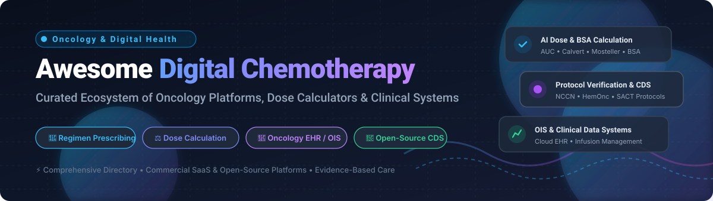
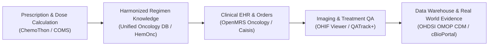

# 💊 Awesome Digital Chemotherapy 🎗️

**Curated List of Leading SaaS Products & Open-Source Oncology Software Ecosystem**  
*Focused on Chemotherapy Prescribing, AI Dose Calculation, Regimen Protocols & Oncology Information Systems (OIS)*  

**Last updated: March 2026**

---

## 📖 Overview & SEO Summary

Welcome to the definitive directory for **Digital Chemotherapy**, **Clinical Oncology Informatics**, and **Cancer Treatment Technologies**. This repository tracks notable enterprise **SaaS platforms**, clinical decision support (CDS) engines, and **open-source GitHub projects** designed to help oncologists, medical physicists, oncology pharmacists, and software developers:
- 💉 **Safely prescribe and order Systemic Anti-Cancer Therapy (SACT)**
- 📐 **Perform rigorous chemotherapy dose calculations** (BSA, Calvert AUC, CrCl, carboplatin/cisplatin dosing adjustments)
- 📋 **Standardize oncology treatment regimens** and protocol compliance (NCCN, ASCO, HemOnc guidelines)
- 🏥 **Deploy and integrate specialized Oncology EHRs & Oncology Information Systems (OIS)**
- 📉 **Eliminate clinical medication errors** across hospital health systems and resource-constrained cancer clinics

---

## 📑 Table of Contents

- [📊 Sector Overview & Market Dynamics](#-sector-overview--market-dynamics)
- [☁️ SaaS & Hosted Platforms](#️-saas--hosted-platforms)
- [🔓 Open-Source GitHub Projects](#-open-source-github-projects)
- [🏗️ Architectural Frameworks for Custom Platforms](#️-architectural-frameworks-for-custom-platforms)
- [🤝 How to Contribute](#-how-to-contribute)
- [💖 Support & Sponsorship](#-support--sponsorship)
- [⭐ Star History](#-star-history)
- [⚠️ Disclaimer & Clinical Safety](#️-disclaimer--clinical-safety)

---

## 📊 Sector Overview & Market Dynamics

The global **Oncology Information Systems (OIS)** and digital chemotherapy prescribing market is estimated at approximately **$5.7 billion to $10.3 billion**, accelerating at a compound annual growth rate (**CAGR of 7.5%–8.5%**). 

The industry is defined by a **concentrated, oligopolistic core** among enterprise radiation and hospital-wide healthcare tech titans (notably **Siemens Healthineers / Varian ARIA**, **Elekta MOSAIQ**, and **Roche / Flatiron Health**). Concurrently, the ambulatory and outpatient ecosystem exhibits **moderate fragmentation**, creating substantial demand for modular clinical decision support plugins, standardized regimen knowledge graphs (e.g., HemOnc), and interoperable open-source dose verification tools.

---

## ☁️ SaaS & Hosted Platforms

| Platform | Company / Parent | Valuation / Revenue (Size Indicator) | Description & Focus | Starting Pricing | Free Tier / Trial Limits |
|:---|:---|:---|:---|:---|:---|
| **[IntellidoseTxM](https://www.intellidose.com/)** | Cencora (AmerisourceBergen) | ~$293.96B annual revenue | Chemotherapy dose management and infusion analytics platform optimizing protocol compliance, order tracking, and oncology drug cost control. | Contact vendor for custom quote (Enterprise pricing structured per infusion chair / practice site; IntrinsiQ acquired for $35M) | No free tier or self-service free trial; access requires a scheduled clinical demo and guided implementation. |
| **[OncoEMR](https://flatiron.com/oncoemr/)** | Flatiron Health (Roche Group) | $1.9B acquisition valuation | Cloud-based oncology-specific EHR supporting chemotherapy order entry, regimen management, clinical workflows, and real-world evidence. | Starts at ~$1,300–$1,400 per provider/month (plus one-time setup/implementation fees) | No free tier or self-service free trial; access provided via scheduled institutional live demonstrations. |
| **[Flatiron Assist](https://flatiron.com/)** | Flatiron Health (Roche Group) | $1.9B acquisition valuation | Clinical decision support platform embedded in OncoEMR offering NCCN-aligned chemotherapy regimen recommendations and trial matching. | Add-on module licensing to OncoEMR (integrated contract, starting per provider/clinic baseline) | No free tier or self-service free trial; demo access and workflow evaluation provided via Flatiron sales team. |
| **[Varian ARIA](https://www.varian.com/products/software/aria-oncology-information-system)** | Siemens Healthineers | $16.4B acquisition valuation (~$24B parent revenue) | Enterprise oncology information system unifying medical oncology, chemotherapy prescribing, and radiation therapy workflows. | Software modules start around ~$75,000 baseline deployment fee (scales based on concurrent user licenses and linac connectors) | No free tier or public free trial; access provided via scheduled product consultations and sandbox demonstrations. |
| **[Elekta MOSAIQ](https://www.elekta.com/products/software/mosaiq/)** | Elekta AB | ~$1.7B annual revenue (~SEK 18B) | Comprehensive oncology EHR & information system managing medical oncology, chemotherapy orders, pharmacy verification, and radiation. | Enterprise software licensing starting per server/database instance + annual maintenance (quote-based) | No free tier or public free trial; vendor-guided workflow demonstrations available upon request. |
| **[CenseoRx](https://www.censeohealth.com/)** | Signify Health (CVS Health) | $8.0B acquisition valuation by CVS | Clinical decision support platform with oncology treatment pathways, regimen analytics, and prior authorization management. | Enterprise contract pricing per covered lives / member population | No free tier or self-service free trial; access restricted to health plan and provider enterprise demonstrations. |
| **[ChemoCare](https://www.chemocare.com/)** | Cleveland Clinic Cancer Center | ~$14.5B annual system revenue | Comprehensive chemotherapy drug profiles, standard dosing references, regimen details, and adverse effect management database. | $0 (100% free open public access resource funded by Cleveland Clinic Cancer Center) | Free forever for all users globally with unlimited web queries and regimen searches. |
| **[CureMD](https://www.curemd.com/)** | CureMD Healthcare | ~$50M–$100M estimated revenue | Cloud-based oncology EHR offering chemotherapy regimen management, clinical charting, patient portals, and billing/RCM. | Starts at $295 per provider/month (EHR only) or $395 per provider/month (All-in-One EHR + Practice Management) | No free tier or free trial; access provided via scheduled live product walk-through and guided demo. |
| **[EpiSoft](https://www.episoft.com.au/)** | EpiSoft Pty Ltd | ~$10M–$20M estimated revenue | Specialty oncology information system featuring chemotherapy prescribing, chair management, and protocol tracking for ANZ markets. | Utilization-based SaaS priced per billable treatment visit (implementation budgeted around 3-year license fee) | No free tier or public trial; prospective clinics receive guided product sandbox trials upon consultation. |
| **[iQemo](https://www.iqemo.com/)** | iQ HealthTech (Altera Digital Health) | ~$5M–$15M estimated revenue | Electronic chemotherapy and SACT prescribing system with regimen templates and dose calculation designed for NHS Trusts. | Cloud SaaS subscription priced according to SACT patient volume / trust size (available via UK Crown Commercial G-Cloud framework) | No free tier or public trial; access is restricted to NHS/hospital staff via scheduled institutional pilot demos. |

---

## 🔓 Open-Source GitHub Projects

*Active open-source repositories and clinical software sorted descending by GitHub stargazers count.*

1. **[OHIF/Viewers](https://github.com/OHIF/Viewers)**   
   Open-source zero-footprint web imaging platform and medical viewer (MIT license). Includes a specialized **Lesion Tracker** extension for oncology trials (RECIST 1.1 criteria), DICOM-SR measurements, and oncology imaging review workflows integrated with PACS and clinical trial data.

2. **[openmrs/openmrs-core](https://github.com/openmrs/openmrs-core)**   
   Core electronic medical record platform (MPL-2.0) powering oncology care delivery across low- and middle-income countries (LMICs). Hosts specialized oncology extensions for chemotherapy order documentation, cancer patient registries, and longitudinal follow-up tracking.

3. **[cBioPortal/cbioportal](https://github.com/cBioPortal/cbioportal)**   
   Open-access cancer genomics and clinical data analysis system (AGPLv3) developed by Memorial Sloan Kettering Cancer Center. Facilitates the integration of molecular oncology profiles with chemotherapy treatment outcomes and survival data.

4. **[nf-core/sarek](https://github.com/nf-core/sarek)**   
   Comprehensive Nextflow analysis pipeline (MIT license) for germline and somatic cancer variant detection. Serves as essential computational infrastructure for precision chemotherapy and targeted oncological therapies.

5. **[OpenClinica/OpenClinica](https://github.com/OpenClinica/OpenClinica)**   
   Community open-source electronic data capture (EDC) and clinical data management platform (LGPL). Widely deployed for oncology clinical trials, protocol deviation tracking, and chemotherapy safety monitoring.

6. **[dcm4che/dcm4chee-arc-light](https://github.com/dcm4che/dcm4chee-arc-light)**   
   Next-generation DICOM archive and clinical image manager (LGPL). Provides the image management and DICOM RT storage layer required to link radiation oncology and chemotherapy treatment monitoring.

7. **[e0404/matRad](https://github.com/e0404/matRad)**   
   Open-source radiation treatment planning system in MATLAB/GNU Octave (GPLv3). Features Monte Carlo dose calculation, biological optimization, multimodality planning, and DICOM-RT import/export funded by the German Cancer Aid (DKH).

8. **[bastula/dicompyler](https://github.com/bastula/dicompyler)**   
   Extensible radiation therapy research platform and viewer for DICOM and DICOM-RT (BSD license). Features dose-volume histogram (DVH) analysis, 2D/3D slice viewing, and structure set parsing.

9. **[judegomila/OnCo](https://github.com/judegomila/OnCo)**   
   Open-source cancer knowledge graph and API indexing therapies, molecular targets, clinical trials, and oncology treatments into a unified searchable platform with CLI and MCP server support.

10. **[cutright/DVH-Analytics](https://github.com/cutright/DVH-Analytics)**   
    Open-source Python and SQLite application for radiation oncology and chemotherapy-adjacent clinical analytics, dose-volume histogram database queries, and statistical modeling.

11. **[qatrackplus/qatrackplus](https://github.com/qatrackplus/qatrackplus)**   
    Configurable, free, and open-source (MIT/Apache-2.0) web application for quality assurance (QA) and QC management in radiation therapy and oncology clinics. Actively maintained by the Ottawa Hospital Cancer Centre.

12. **[OHDSI/OncologyWG](https://github.com/OHDSI/OncologyWG)**   
    Open Health Data Sciences and Informatics (OHDSI) Oncology Working Group repository standardizing cancer treatment representation, chemotherapy regimen mapping, and OMOP CDM oncology extensions.

13. **[immortal71/openoncology](https://github.com/immortal71/openoncology)**   
    Open-source precision oncology platform that ranks FDA-approved and drug-repurposing candidates from a patient's variant profile using OncoKB, AlphaMissense, OpenTargets, and ChEMBL evidence.

14. **[openmrs/openmrs-module-oncology](https://github.com/openmrs/openmrs-module-oncology)**   
    Specialized chemotherapy ordering, regimen prescription, and cancer documentation module developed within OpenMRS for oncology teams in resource-limited environments.

15. **[VHAINNOVATIONS/COMS-PROTO](https://github.com/VHAINNOVATIONS/COMS-PROTO)**   
    Chemotherapy Ordering Management System (COMS) prototype developed by Veterans Health Administration innovations—web-based clinical tool for regimen preparation, order checking, and treatment documentation.

16. **[OpenTPS/examples](https://github.com/OpenTPS/examples)**   
    Official examples for OpenTPS, an open-source treatment planning system supporting Monte Carlo dose calculations (MCsquare), multi-criteria optimization, and proton/photon radiotherapy workflows.

17. **[Phillippus/ChemoThon](https://github.com/Phillippus/ChemoThon)**   
    AI-assisted chemotherapy prescribing platform evolved into a Streamlit web application. Features **67 curated regimens** across breast, colorectal, gastrointestinal, gynecological, and immunotherapy cancers with automated BSA/weight-based dose calculations.

18. **[Caisis/Caisis](https://github.com/Caisis/Caisis)**   
    Open-source cancer data management system (GPL) originally developed at Memorial Sloan-Kettering Cancer Center. Features patient history capture, tumor banking, clinical trials protocol management, and longitudinal oncology tracking.

19. **[Unified Oncology Treatment Database](https://zenodo.org/records/22181331)**   
    Multisource harmonized database from Oak Ridge National Laboratory and the National Cancer Institute (NCI). Standardizes anticancer regimens, RxNorm ingredient mappings, and clinical trial intervention terminology across 11 production CSV tables.

20. **[CanReg5 & DHIS2 Cancer Interop](https://www.iarc.who.int/)**   
    World Health Organization (WHO) / International Agency for Research on Cancer (IARC) open toolset for population-based cancer registry data collection, quality control, and national cancer surveillance systems.

---

## 🏗️ Architectural Frameworks for Custom Platforms

Oncology engineering teams can combine best-of-breed open-source modules to engineer complete, vendor-independent digital chemotherapy architectures:

---

## 🤝 How to Contribute

Contributions from medical oncologists, clinical informaticists, pharmacists, and health-tech developers are warmly welcomed!

1. 🍴 **Fork the repository**
2. 🌿 **Create a new branch**: `git checkout -b feature/add-oncology-tool`
3. 📝 **Add entries following the established format**:
   - Platform / Repository name with official URL
   - GitHub stars social badge linking directly to stargazers
   - 1–2 factual sentences describing clinical utility, license, and regimen handling
4. 🚀 **Submit a Pull Request** with clear release context

---

## 💖 Support & Sponsorship

If you find this curated digital oncology directory valuable for your clinical practice, research, or development:

- ⭐ **Star this repository** to improve visibility for clinicians and developers worldwide
- 🍴 **Fork and share** with colleagues in oncology informatics and medical physics
- ☕ **Support the maintainer**: Buy a coffee or become a sponsor via the [GitHub Sponsors Dashboard](https://github.com/sponsors/ishandutta2007)

---

## ⭐ Star History

---

## ⚠️ Disclaimer & Clinical Safety

- 🩺 **Community Curated**: This compilation is for informational, academic, and research purposes only. Inclusion does not constitute clinical certification or official medical endorsement.
- ⚖️ **Regulatory Compliance**: All digital chemotherapy systems processing Protected Health Information (PHI) or generating medication orders must adhere to rigorous medical device regulations (e.g., FDA 21 CFR Part 11 / SaMD, EU MDR 2017/745, HIPAA, GDPR).
- 🧑‍⚕️ **Mandatory Oncologist Oversight**: Every chemotherapy prescription, BSA dose calculation, Calvert formula output, and regimen alteration must be independently validated by a licensed oncologist and verified by an oncology clinical pharmacist prior to patient administration.

---

  <b>Built for oncologists, medical physicists, clinical informaticists, and health-tech pioneers advancing safe, accessible cancer care.</b>

